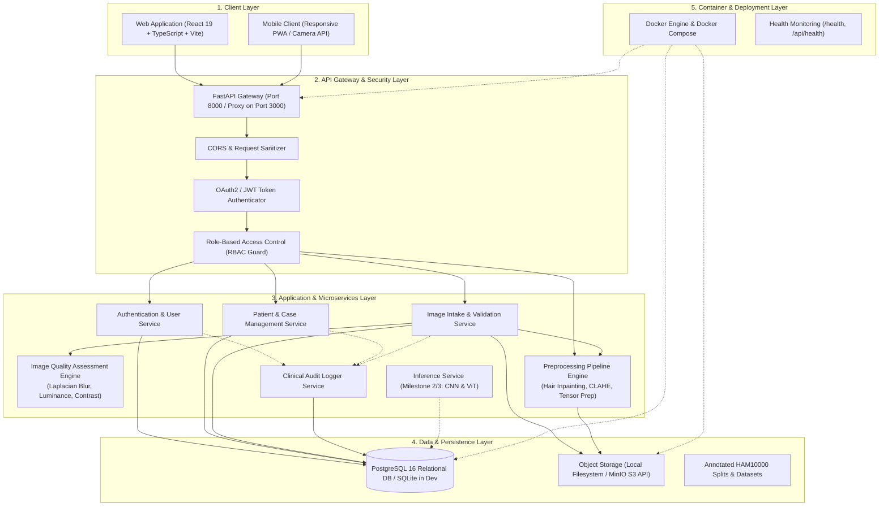

# DermAI: System Architecture Design
## Milestone 1: Multi-Tier Clinical AI Architecture

> **Regulatory & Clinical Notice**: AI-assisted analysis, not a standalone medical diagnosis.

---

### 1. System Architecture Overview

DermAI is architected with clear layer separation across Client Applications, API Gateway / Auth Layer, Application & ML Services, Data & Storage Layer, and Cloud/Container Infrastructure.

---

### 2. Layer-by-Layer Architecture Details

#### 1. Client Layer
- **Desktop & Clinician Interface**: High-density workstation dashboard built with React 19, Tailwind CSS, Lucide icons, and responsive layouts. Supports side-by-side comparative inspection between raw lesion captures and preprocessed/filtered tensors.
- **Mobile Touch Interface**: Mobile-first responsive view with direct HTML5 camera capture, live preview, and immediate quality screening feedback prior to case submission.

#### 2. Gateway & Security Layer
- **Reverse Proxy**: Vite/Express middleware in development routing `/api/*` to FastAPI on port 8000, or running unified full-stack server.
- **JWT Authentication**: HS256-signed JSON Web Tokens carrying `sub` (user_id), `email`, and `role`. Tokens expire after 60 minutes with stateless validation.
- **RBAC Policy Matrix**:
  - `patient`: Can create cases, upload images, read own cases and images.
  - `clinician`: Can view all patient cases, inspect quality metrics, add clinical notes, and review images.
  - `researcher`: Read-only access to de-identified cases, metadata, and dataset distributions.
  - `ml_engineer`: Access to dataset splits, quality metric statistics, and preprocessing endpoints.
  - `admin`: Full administrative control, user activation/deactivation, and complete immutable audit log inspection.

#### 3. Core Services
- **Intake & Quality Gate**: Performs synchronous image validation and CV-based quality assessment on upload:
  1. File signature and MIME check (`image/jpeg`, `image/png`).
  2. Byte size limit check ($\le 10$ MB).
  3. Resolution threshold ($W \ge 224, H \ge 224$).
  4. Laplacian variance blur calculation ($\sigma^2 < 80$ flagged as Poor).
  5. Gray-level mean and standard deviation for under/overexposure.
- **Medical Preprocessing Pipeline**: Standalone Python module (`ml/preprocessing/pipeline.py`) integrated into both offline model training and online FastAPI endpoints (`POST /images/{id}/preprocess`).
- **Audit Logging**: Emits structured audit records for compliance (actions: `REGISTER`, `LOGIN`, `CASE_CREATE`, `IMAGE_UPLOAD`, `NOTE_ADD`).

#### 4. Persistence & Storage
- **PostgreSQL 16 / SQLite**: Stores relational metadata with strict foreign keys and indexed query paths.
- **Pluggable Storage Provider**: Configurable via `STORAGE_BACKEND` (`local` or `minio`). In local mode, files are stored deterministically under `backend/storage/images/{case_id}/{image_id}.jpg`.
