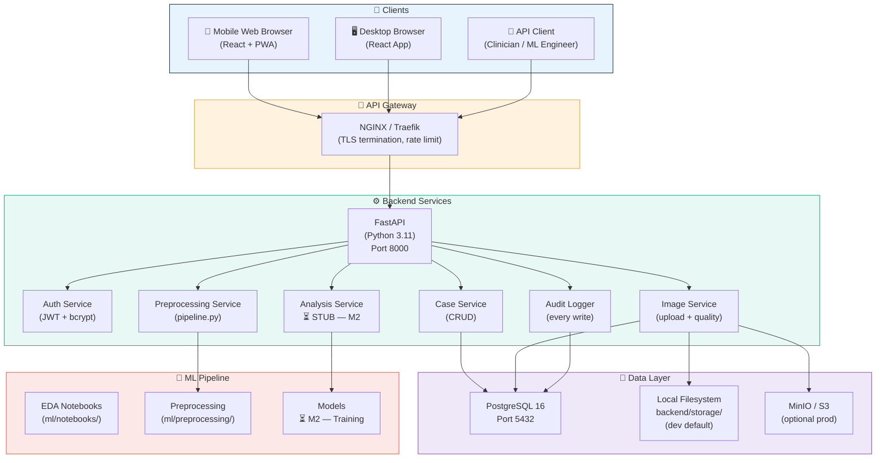
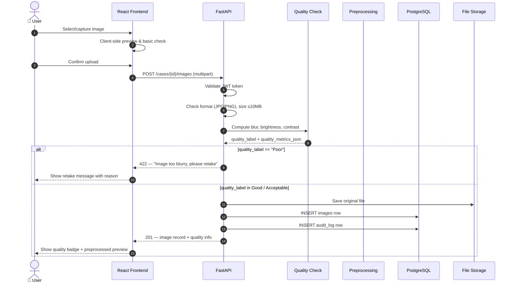
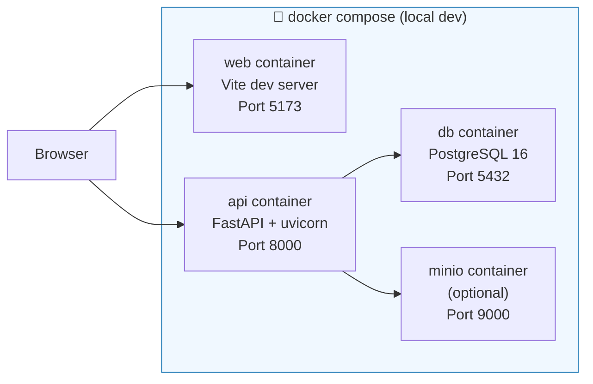

# DermAI — System Architecture

> ⚠️ **AI-assisted analysis, not a standalone medical diagnosis.**

---

## 1. High-Level Architecture

---

## 2. Request Flow — Image Upload

---

## 3. Deployment Architecture (Milestone 1 — Local Docker)

---

## 4. Technology Decisions

| Component | Choice | Rationale |
|-----------|--------|-----------|
| **API Framework** | FastAPI | Async, auto OpenAPI docs, Pydantic v2 validation |
| **ORM** | SQLAlchemy 2 | Async sessions, type-safe, Alembic migration support |
| **Auth** | JWT (HS256) + bcrypt | Stateless tokens; industry standard |
| **Database** | PostgreSQL 16 | JSON columns for metrics; full ACID; JSONB indexing |
| **Storage** | Local FS → MinIO | Start simple; abstract via `STORAGE_BACKEND` env var |
| **Frontend** | React + Vite + TypeScript | Fast HMR; type safety; large ecosystem |
| **Styling** | Tailwind CSS | Utility-first; responsive; no CSS battles |
| **ML** | NumPy + OpenCV + Pillow | Standard; no heavy framework for preprocessing |
| **Container** | Docker + compose | Reproducible; one-command startup |

---

## 5. Security Design

| Concern | Mitigation |
|---------|-----------|
| Authentication | JWT with short expiry (30min access) + refresh tokens |
| Authorization | Role-based middleware (`require_role`) per endpoint |
| Data privacy | No real patient data in dev; de-identified records only |
| Secrets | All credentials in `.env` (excluded from Git) |
| Upload safety | File type check (magic bytes), size limit, sanitized filenames |
| Audit trail | Every write logged to `audit_logs` with user + IP + timestamp |
| CORS | Restricted to `CORS_ORIGINS` env variable |
| SQL injection | SQLAlchemy ORM (parameterized queries) |
