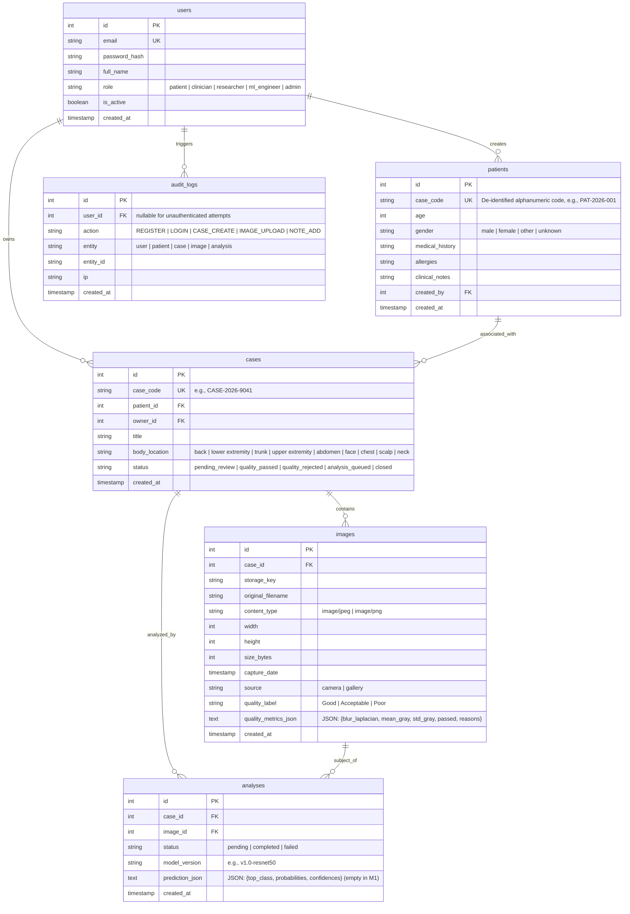

# DermAI: Database Design and Schema Specification
## Milestone 1: Relational Entity-Relationship Model

> **Regulatory & Clinical Notice**: AI-assisted analysis, not a standalone medical diagnosis. All patient records in this database are strictly de-identified.

---

### 1. Entity-Relationship (ER) Diagram

---

### 2. Table Schemas & Constraints

#### Table: `users`
| Column | Type | Constraints | Description |
| :--- | :--- | :--- | :--- |
| `id` | INTEGER | PRIMARY KEY, AUTOINCREMENT | Unique user identifier |
| `email` | VARCHAR(255) | UNIQUE, NOT NULL, INDEXED | User login email |
| `password_hash` | VARCHAR(255) | NOT NULL | Bcrypt / Argon2 hashed password |
| `full_name` | VARCHAR(255) | NOT NULL | Display name |
| `role` | VARCHAR(32) | NOT NULL, DEFAULT 'patient' | Enum: `patient`, `clinician`, `researcher`, `ml_engineer`, `admin` |
| `is_active` | BOOLEAN | NOT NULL, DEFAULT TRUE | Soft disable flag |
| `created_at` | TIMESTAMP | NOT NULL, DEFAULT NOW() | Account creation timestamp |

#### Table: `patients`
*De-identified medical record store. No PII (names, phone numbers, SSNs) is permitted.*
| Column | Type | Constraints | Description |
| :--- | :--- | :--- | :--- |
| `id` | INTEGER | PRIMARY KEY, AUTOINCREMENT | Internal patient record ID |
| `case_code` | VARCHAR(64) | UNIQUE, NOT NULL, INDEXED | Pseudonymous clinical identifier |
| `age` | INTEGER | NULLABLE | Patient age in years |
| `gender` | VARCHAR(32) | NULLABLE | Standardized gender |
| `medical_history` | TEXT | NULLABLE | De-identified dermatological background |
| `allergies` | TEXT | NULLABLE | Known relevant drug/topical allergies |
| `clinical_notes` | TEXT | NULLABLE | Clinician initial intake remarks |
| `created_by` | INTEGER | FOREIGN KEY (`users.id`) | Submitting user ID |
| `created_at` | TIMESTAMP | NOT NULL, DEFAULT NOW() | Record creation date |

#### Table: `cases`
| Column | Type | Constraints | Description |
| :--- | :--- | :--- | :--- |
| `id` | INTEGER | PRIMARY KEY, AUTOINCREMENT | Internal case ID |
| `case_code` | VARCHAR(64) | UNIQUE, NOT NULL, INDEXED | Unique tracking code (e.g. `CASE-2026-X12`) |
| `patient_id` | INTEGER | FOREIGN KEY (`patients.id`), NULLABLE | Related de-identified patient |
| `owner_id` | INTEGER | FOREIGN KEY (`users.id`), NOT NULL | Submitting user |
| `title` | VARCHAR(255) | NOT NULL | Clinical case subject / concern |
| `body_location` | VARCHAR(64) | NOT NULL | Anatomical site aligned with HAM10000 |
| `status` | VARCHAR(32) | NOT NULL, DEFAULT 'pending_review' | Case progression state |
| `created_at` | TIMESTAMP | NOT NULL, DEFAULT NOW() | Submission timestamp |

#### Table: `images`
| Column | Type | Constraints | Description |
| :--- | :--- | :--- | :--- |
| `id` | INTEGER | PRIMARY KEY, AUTOINCREMENT | Unique image record ID |
| `case_id` | INTEGER | FOREIGN KEY (`cases.id`), NOT NULL | Owning case ID |
| `storage_key` | VARCHAR(512) | NOT NULL | Relative path or S3 key |
| `original_filename` | VARCHAR(255) | NOT NULL | Uploaded file name |
| `content_type` | VARCHAR(64) | NOT NULL | MIME type (`image/jpeg`, `image/png`) |
| `width` | INTEGER | NOT NULL | Pixel width |
| `height` | INTEGER | NOT NULL | Pixel height |
| `size_bytes` | INTEGER | NOT NULL | File size in bytes (max 10MB) |
| `capture_date` | TIMESTAMP | NULLABLE | EXIF or upload capture date |
| `source` | VARCHAR(32) | NOT NULL, DEFAULT 'camera' | Enum: `camera`, `gallery` |
| `quality_label` | VARCHAR(32) | NOT NULL | Quality evaluation: `Good`, `Acceptable`, `Poor` |
| `quality_metrics_json` | TEXT | NOT NULL | Full JSON breakdown of CV quality metrics |
| `created_at` | TIMESTAMP | NOT NULL, DEFAULT NOW() | Upload timestamp |

#### Table: `analyses` *(Milestones 2–4 Schema)*
| Column | Type | Constraints | Description |
| :--- | :--- | :--- | :--- |
| `id` | INTEGER | PRIMARY KEY, AUTOINCREMENT | Analysis inference run ID |
| `case_id` | INTEGER | FOREIGN KEY (`cases.id`), NOT NULL | Associated case |
| `image_id` | INTEGER | FOREIGN KEY (`images.id`), NOT NULL | Evaluated image |
| `status` | VARCHAR(32) | NOT NULL, DEFAULT 'pending' | `pending`, `completed`, `failed` |
| `model_version` | VARCHAR(64) | NULLABLE | Model identifier |
| `prediction_json` | TEXT | NULLABLE | Top-N probability vector & class predictions |
| `created_at` | TIMESTAMP | NOT NULL, DEFAULT NOW() | Inference timestamp |

#### Table: `audit_logs`
| Column | Type | Constraints | Description |
| :--- | :--- | :--- | :--- |
| `id` | INTEGER | PRIMARY KEY, AUTOINCREMENT | Immutable audit event ID |
| `user_id` | INTEGER | FOREIGN KEY (`users.id`), NULLABLE | Actor user ID |
| `action` | VARCHAR(64) | NOT NULL | Event name (e.g., `LOGIN`, `IMAGE_UPLOAD`) |
| `entity` | VARCHAR(64) | NOT NULL | Target entity type (`case`, `image`, etc.) |
| `entity_id` | VARCHAR(64) | NULLABLE | Affected entity record key |
| `ip` | VARCHAR(45) | NULLABLE | Client IP address |
| `created_at` | TIMESTAMP | NOT NULL, DEFAULT NOW() | Event timestamp |
