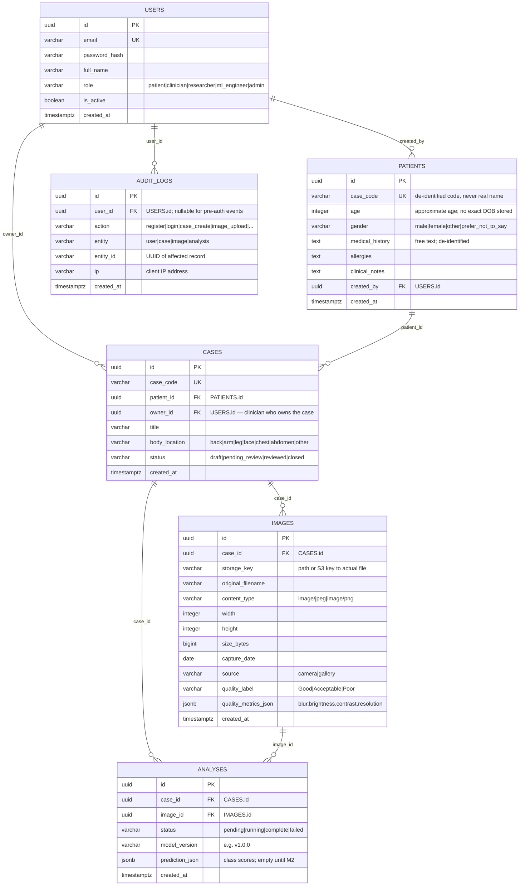

# DermAI — Database Design

> ⚠️ **AI-assisted analysis, not a standalone medical diagnosis.**

---

## 1. Entity-Relationship Diagram



---

## 2. Table Descriptions

### `users`
Central identity table. Roles are enforced by the API layer.

| Column | Type | Notes |
|--------|------|-------|
| `id` | UUID (PK) | `gen_random_uuid()` default |
| `email` | VARCHAR(255) | Unique, lowercased, indexed |
| `password_hash` | VARCHAR(255) | bcrypt hash; never plaintext |
| `full_name` | VARCHAR(255) | Display name |
| `role` | ENUM | `patient`, `clinician`, `researcher`, `ml_engineer`, `admin` |
| `is_active` | BOOLEAN | Soft deactivation; defaults true |
| `created_at` | TIMESTAMPTZ | UTC, server-generated |

### `patients`
De-identified patient record. Created by clinicians or admins only.
**Never store: full name, DOB, address, national ID, phone, email.**

| Column | Type | Notes |
|--------|------|-------|
| `case_code` | VARCHAR | Clinic-assigned opaque code, e.g. `PT-2024-001` |
| `age` | INTEGER | Approximate; no exact birth date |
| `gender` | VARCHAR | `male`/`female`/`other`/`prefer_not_to_say` |
| `medical_history` | TEXT | De-identified free text |
| `created_by` | UUID FK | Clinician who created the record |

### `cases`
A clinical case links a patient to a set of images and analyses.

| Column | Type | Notes |
|--------|------|-------|
| `status` | VARCHAR | `draft` → `pending_review` → `reviewed` → `closed` |
| `body_location` | VARCHAR | Anatomical location of the lesion |
| `owner_id` | UUID FK | Clinician responsible for review |

### `images`
Stores metadata about each uploaded image. The actual file is on disk or S3.

| Column | Type | Notes |
|--------|------|-------|
| `storage_key` | VARCHAR | Relative path (local) or S3 object key |
| `quality_label` | VARCHAR | `Good` / `Acceptable` / `Poor` |
| `quality_metrics_json` | JSONB | `{"blur": 142.3, "brightness": 127, "contrast": 48.2, "resolution": "600x450"}` |
| `source` | VARCHAR | `camera` (captured in-app) or `gallery` (uploaded from library) |

**Quality Thresholds:**

| Metric | Good | Acceptable | Poor |
|--------|------|------------|------|
| Laplacian variance (blur) | ≥ 100 | 50–99 | < 50 |
| Mean gray (brightness) | 80–200 | 50–79 or 201–230 | < 50 or > 230 |
| Std dev gray (contrast) | ≥ 40 | 20–39 | < 20 |
| Short side (resolution) | ≥ 600px | 224–599px | < 224px |

### `analyses`
Stores AI analysis results. In Milestone 1 this is a stub — `prediction_json` is empty.

| Column | Type | Notes |
|--------|------|-------|
| `status` | VARCHAR | `pending` → `running` → `complete` / `failed` |
| `model_version` | VARCHAR | Semver of the model used |
| `prediction_json` | JSONB | `{"mel": 0.82, "nv": 0.10, ...}` — filled in M2 |

### `audit_logs`
Append-only log of all state-changing actions. Never deleted.

| Column | Type | Notes |
|--------|------|-------|
| `action` | VARCHAR | `register`, `login`, `case_create`, `image_upload`, `role_change`, etc. |
| `entity` | VARCHAR | Table name of affected record |
| `entity_id` | VARCHAR | UUID of affected record |
| `ip` | VARCHAR | Client IP (from request headers; behind proxy via `X-Forwarded-For`) |

---

## 3. Indexes

```sql
-- Fast email lookup during login
CREATE UNIQUE INDEX idx_users_email ON users(email);

-- Case queries by patient / owner / status
CREATE INDEX idx_cases_patient_id ON cases(patient_id);
CREATE INDEX idx_cases_owner_id ON cases(owner_id);
CREATE INDEX idx_cases_status ON cases(status);

-- Image queries by case
CREATE INDEX idx_images_case_id ON images(case_id);

-- Analysis lookup
CREATE INDEX idx_analyses_case_id ON analyses(case_id);
CREATE INDEX idx_analyses_image_id ON analyses(image_id);

-- Audit log queries by user and time
CREATE INDEX idx_audit_user_id ON audit_logs(user_id);
CREATE INDEX idx_audit_created_at ON audit_logs(created_at);
```

---

## 4. Role Access Matrix

| Endpoint | patient | clinician | researcher | ml_engineer | admin |
|----------|---------|-----------|------------|-------------|-------|
| Register / Login | ✅ | ✅ | ✅ | ✅ | ✅ |
| GET /users/me | ✅ | ✅ | ✅ | ✅ | ✅ |
| GET /cases (all) | ❌ | ✅ | ✅ (read) | ❌ | ✅ |
| GET /cases (own) | ✅ | ✅ | ❌ | ❌ | ✅ |
| POST /cases | ✅ | ✅ | ❌ | ❌ | ✅ |
| POST /cases/{id}/images | ✅ | ✅ | ❌ | ❌ | ✅ |
| GET /images/{id}/preprocess | ❌ | ✅ | ❌ | ✅ | ✅ |
| GET /audit-logs | ❌ | ❌ | ❌ | ❌ | ✅ |
| POST /users/{id}/role | ❌ | ❌ | ❌ | ❌ | ✅ |
